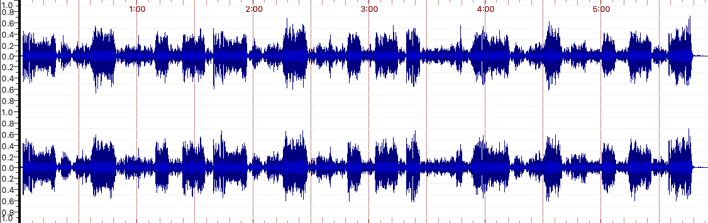
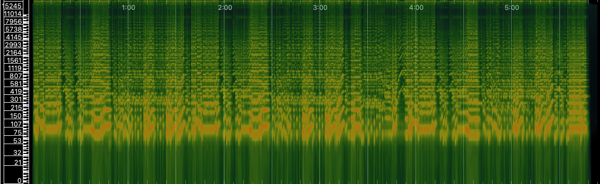
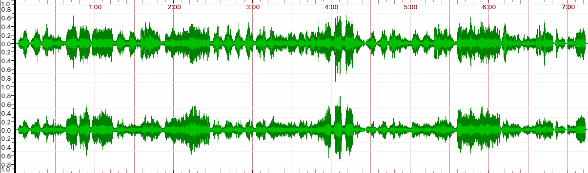
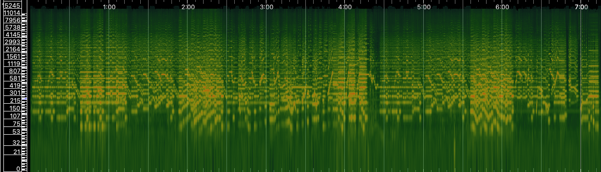
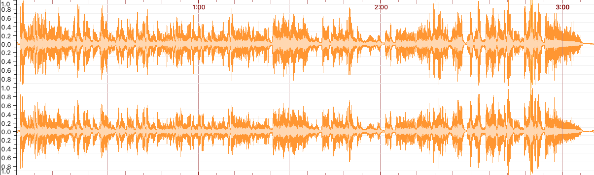
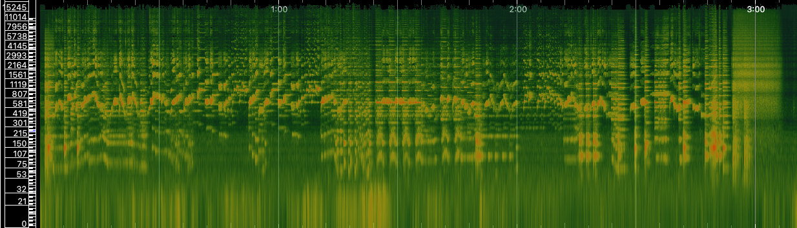

# Week 8: Mozart recordings and audio visualisation

## Task 1: Find and describe three related audio tracks

### Track 01: Eine kleine Nachtmusik, K. 525: I. Allegro

[Listen / download Ogg](data/week8/audio/01_Mozart_K525_I_Allegro_Advent.ogg)

### Track 02: Clarinet Concerto in A major, K. 622: II. Adagio

[Listen / download Ogg](data/week8/audio/02_Mozart_K622_II_Adagio_Krumpoeck.ogg)

### Track 03: The Magic Flute, K. 620: Der Hölle Rache kocht in meinem Herzen

[Listen / download Ogg](data/week8/audio/03_Mozart_K620_Der_Hoelle_Rache_Partridge.ogg)

### Metadata comparison

| Metadata field | Track 01 · K. 525 | Track 02 · K. 622 | Track 03 · K. 620 |
| --- | --- | --- | --- |
| Title | Eine kleine Nachtmusik, K. 525: I. Allegro | Clarinet Concerto in A major, K. 622: II. Adagio | The Magic Flute, K. 620: Der Hölle Rache kocht in meinem Herzen |
| Artist / performers | Advent Chamber Orchestra; musical director: Roxanna Pavel Goldstein | Markus Krumpöck (clarinet); Merkur Orchester Wiener Neustadt; conductor: Willibald Zwittkovits | Sandra Partridge (soprano); Siam Philharmonic Orchestra; conductor: Trisdee na Patalung |
| Composer | Wolfgang Amadeus Mozart | Wolfgang Amadeus Mozart | Wolfgang Amadeus Mozart |
| Recording licence | <a href="https://creativecommons.org/licenses/by-sa/2.0/">CC BY-SA 2.0</a> | <a href="https://creativecommons.org/licenses/by/2.5/">CC BY 2.5</a> | <a href="https://creativecommons.org/licenses/by/2.5/">CC BY 2.5</a> |
| Genre | Classical period; string serenade | Classical period; concerto, slow movement | Classical period; opera aria |
| Source | <a href="https://commons.wikimedia.org/wiki/File:Mozart_-_Eine_kleine_Nachtmusik_-_1._Allegro.ogg">Wikimedia Commons [1]</a> Al Goldstein collection, Pandora Music repository, ibiblio.org | <a href="https://commons.wikimedia.org/wiki/File:Mozart_Clarinet_Concert_-_2._Adagio.ogg">Wikimedia Commons [2]</a> Wikimedia Commons; earlier original source is not specified on the file page | <a href="https://commons.wikimedia.org/wiki/File:Der_Hoelle_Rache.ogg">Wikimedia Commons [3]</a> Live Bangkok Opera recording, Thailand Cultural Centre; published by Trisdee na Patalung |
| Recording date | 2005 or 2006 | 6 January 1999 | 5 April 2006 |
| File / audio format | .ogg; Ogg container / Vorbis codec (lossy) | .ogg; Ogg container / Vorbis codec (lossy) | .ogg; Ogg container / Vorbis codec (lossy) |
| Number of channels | 2 (stereo) | 2 (stereo) | 2 (stereo) |
| Sample rate | 44,100 Hz (44.1 kHz) | 44,100 Hz (44.1 kHz) | 44,100 Hz (44.1 kHz) |
| Bits per second (approximate average) | 258,000 bps (258 kbps) | 103,000 bps (103 kbps) | 158,000 bps (158 kbps) |
| Duration (mm:ss) | 05:55 | 07:15 | 03:11 |

## Task 2: Basic analysis in Sonic Visualiser

### Track 01: K. 525

*Figure 1. Stereo waveform of K. 525.*

*Figure 2. Log-frequency spectrogram of K. 525.*

### Track 02: K. 622

*Figure 3. Stereo waveform of K. 622.*

*Figure 4. Log-frequency spectrogram of K. 622.*

### Track 03: K. 620

*Figure 5. Stereo waveform of K. 620.*

*Figure 6. Log-frequency spectrogram of K. 620.*

## Reflection

## References

1. [Eine kleine Nachtmusik, K. 525: I. Allegro](https://commons.wikimedia.org/wiki/File:Mozart_-_Eine_kleine_Nachtmusik_-_1._Allegro.ogg)
2. [Clarinet Concerto in A major, K. 622: II. Adagio](https://commons.wikimedia.org/wiki/File:Mozart_Clarinet_Concert_-_2._Adagio.ogg)
3. [The Magic Flute, K. 620: Der Hölle Rache kocht in meinem Herzen](https://commons.wikimedia.org/wiki/File:Der_Hoelle_Rache.ogg)

## AI assistance

